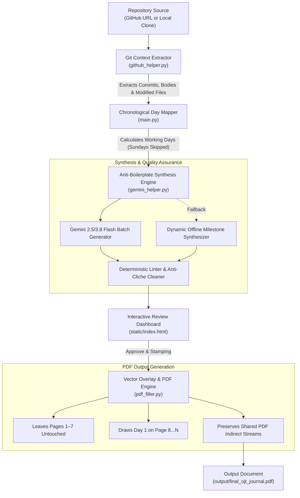

# OJL Book Maker — Automated Technical Journal Engine

[](https://fastapi.tiangolo.com)
[](https://www.python.org/)
[](https://www.reportlab.com/)
[](LICENSE)

An enterprise-grade, privacy-centric **Daily Activity Journal (OJL / OJT) PDF Auto-Filler**. 

Point the engine to your **GitHub repository** (or local clone on disk) and specify your internship dates: it analyzes the repository's **commit history, modified file paths, and architecture**, synthesizes authentic daily engineering activity logs (skipping all Sundays), preserves the introductory handbook pages (Pages 1–7) completely untouched, and writes Day 1 directly onto **Page 8** using a high-performance vector PDF overlay.

---

## 🏗️ Architecture & Pipeline



---

## ⚡ Core Innovations & Upstream Comparison

This project was originally inspired by `vishnums2k5/OJL-Maker`, but has been almost completely rewritten (**>80% new codebase**) to resolve fundamental flaws in the upstream project:

| Feature | Upstream (`vishnums2k5/OJL-Maker`) | This Enhanced Engine |
| :--- | :--- | :--- |
| **Input Workflow** | Requires typing/pasting manual Markdown for 60–90 days by hand. | **100% Automated from Git**: Reads commits and modified files directly. |
| **Private Repositories** | No support for private repos. | **Dual Support**: Works with GitHub Personal Access Tokens (PAT) and offline local folders (`/path/to/repo`). |
| **Handbook Integrity** | Overwrote student profile data onto Page 3, breaking template layout. | **Strictly Untouched**: Pages 1–7 remain 100% pristine. Day 1 starts on **Page 8**. |
| **Sunday Handling** | Manual date math or fragile string inputs. | **Automatic**: Calculates active working dates between start & end, automatically skipping Sundays. |
| **PDF File Size** | Used `copy.deepcopy`, causing PDF file bloat to **1.1+ GB**. | **Stream Optimization**: Preserves shared PDF indirect objects, producing a compact **~60 MB** file. |
| **Writing Quality** | Formulaic, repetitive AI resume-speak ("Focused on enhancing...", "Successfully implemented..."). | **Anti-Boilerplate Engine**: Banned cliché registry, active developer voice, and concrete file references. |
| **UI Design** | Basic template form. | **Production-grade dark mode UI** built with the Impeccable design system. |

---

## ✨ Features

- **GitHub Remote & Local Disk Ingestion**: Accepts public GitHub links, private repositories via fine-grained Personal Access Tokens (`GITHUB_TOKEN`), or direct local directory paths on your machine without needing network access.
- **Concrete Technical Grounding**: Daily logs reference actual files modified (e.g. `PromptBox.tsx`, `Sidebar.tsx`, `WebSocketContext.tsx`) and real tools used.
- **Strict Anti-Boilerplate Linter**: Eliminates repetitive AI cliches (`"Successfully implemented"`, `"Focused on enhancing"`, `"Designed a robust"`) and enforces an authentic software engineer voice.
- **Structured Bounding Box Placement**: Overlays text into designated boxes (`MY SPACE`, `Tasks Carried Out`, `Key Learnings`, `Tools Used`, `Special Achievements`) using large, legible typography (~10.5 pt) and clean bullet points (`• `).
- **Dual Synthesis Modes**: Uses Google Gemini AI in automated retried batches, and includes a rich progressive offline synthesizer that never relies on static template repetitions.

---

## 🗂 Project Structure

```
OJL-Maker/
├── input/                  # Place your empty OJT template PDF here
├── output/                 # Generated final OJL journals are saved here
├── main.py                 # FastAPI backend, routing, and background tasks
├── github_helper.py        # Git commit extractor (local & remote API + Atom feed)
├── gemini_helper.py        # Anti-boilerplate synthesis engine & post-processing linter
├── pdf_filler.py           # ReportLab transparent vector overlay & PyPDF2 stream merger
├── static/
│   └── index.html          # Polished, accessible dark-mode single page application
└── requirements.txt        # Minimal, pinned Python dependencies
```

---

## 🚀 Quickstart

### Prerequisites
- Python 3.9 or higher
- Git

### 1. Clone & Install
```bash
git clone https://github.com/MrCode-2005/OJL-Maker.git
cd OJL-Maker
pip install -r requirements.txt
```

### 2. Configure Environment (Optional)
Copy `.env.example` to `.env`:
```bash
cp .env.example .env
```
Add your optional keys if desired:
```env
GEMINI_API_KEY=your_gemini_api_key
GITHUB_TOKEN=your_github_pat_token
```
*(Note: If omitted, the engine automatically uses its built-in offline synthesizer and local clone reader).*

### 3. Place Your Template PDF
Place your empty OJT template PDF inside the `input/` folder:
```bash
cp "/path/to/your/OJT Logbook.pdf" input/
```
*(You can also drag-and-drop the PDF directly in the browser).*

### 4. Launch Application
```bash
uvicorn main:app --reload
```
Open **http://localhost:8000** in your browser.

---

## 📖 How It Works

1. **Enter Repository & Date Range**:
   - Provide your **GitHub URL** or **Local Directory Path** (e.g., `/Users/username/Developer/my-project`).
   - Select your **First Date (Day 1)** and **Last Date**. The UI automatically displays the active working days count (Sundays excluded).
   - Enter your **OJL Timing**, **Department**, and **Designation** once (automatically stamped across all pages).
2. **Synthesize**:
   - Click **Synthesize Daily Activities**. The engine extracts commits, builds progressive milestones, and runs the anti-boilerplate linter.
3. **Review & Refine**:
   - Scroll through the generated day cards. Refine or edit any bullet point if desired; all changes persist into the final document.
4. **Generate & Export**:
   - Click **Write & Save Final OJL Book**.
   - Download the final PDF or grab it directly from `output/final_ojt_journal.pdf`.

---

## 📄 License
This project is licensed under the MIT License — see the [LICENSE](LICENSE) file for details.
